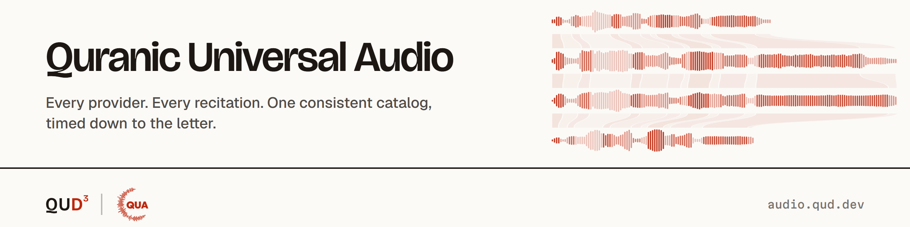

  <a href="https://audio.qud.dev">
    <picture>
      <source media="(prefers-color-scheme: dark)" srcset=".github/banner-ink.png">
      
    </picture>
  </a>

  
  
  
  <!-- stats-badges:start -->
   
     
   
     
  <!-- stats-badges:end -->
   
  
  
  

The all-in-one audio and timing hub for Qur'anic apps, developers, and researchers. A timestamps visualizer, editing tool and community-verified dataset unifying recitations at scale with word- and letter-level timestamps.

  <a href="#key-highlights">Highlights</a> ·
  <a href="#use-cases">Use Cases</a> ·
  <a href="#data-access">Data Access</a> ·
  <a href="#technical-overview">How it works</a> ·
  <a href="#contributing">Contribute</a> ·
  <a href="#roadmap">Roadmap</a> ·
  <a href="#acknowledgements">Acknowledgments</a> ·
  <a href="#license">License</a>

## Highlights

- **Unified Qur'anic audio hub:** A single consistent schema with comprehensive metadata for reciters and recitations instead of scattered websites, CDNs, YouTube playlists, and raw files with different formats.

- **Large-scale, multi-riwayah, multi-style:** Full Qur'an coverage across many recitations and hours of audio, spanning mujawwad, murattal, muallim and taraweeh styles.

- **Precise alignment:** 20ms timing precision yields maximum accuracy, eliminates ambiguity at word boundaries and disambiguates tajweed effects where sounds merge across words.

- **Repetition-aware, gap-free timestamps:** The pipeline transcribes each silence-based segment independently, so repeated words are detected and timestamped correctly. See the [comparison with QUL timestamps](docs/qul_timestamp_comparison.md).

- **Community-driven validation:** No trusting a black-box pipeline. Every stage is automatically checked by dedicated validators and human-correctable through an interactive editing UI. Review flagged errors like missing words or misaligned boundaries, fix them visually, and feed corrections back into the dataset.

- **Submit your own recitations:** Add your favorite reciters and different audio sources to the catalog and we handle the processing — typically within a few days.

- **Metadata and versioning:** Each recitation is governed by consistent schemas and metadata and versioned with a full history to track segment updates and timestamp corrections over time.

## Use Cases

- **Verse playback** — play or seek any ayah or ayah range straight from the original surah audio.
- **Follow-along** — word-by-word highlighting synced to the recitation.
- **Word study** — replay the sound of individual words for learners.
- **ML research** — a large, diverse corpus (reciters, paces, styles, riwayat) for speech recognition, tajweed and reciter identification.

## Data Access

Audio, timestamps and metadata ship in two open formats — pick by your use case.

| | [GitHub Releases](https://github.com/QUD-Technologies/quranic-universal-audio/releases) | [Hugging Face Dataset](https://huggingface.co/datasets/QUD-Technologies/quranic-universal-ayahs) |
|---|---|---|
| **Best for** | Apps, offline use, archives | ML research, analysis, direct audio access |
| **Shape** | JSON per recitation, in ayah / word / letter tiers | Parquet, one row per ayah |
| **Audio** | Not bundled — original surah URLs in `catalog.json` | Embedded per-ayah clip in every row + original URLs |
| **Versioning** | Version-pinned snapshots, reproducible | Rolling — always the latest |
| **Fetch what you need** | Full release or specific reciters | Full dataset or specific reciters, Hugging Face supported live viewer, filtering and querying |

## Contributing

Visit the [website](https://audio.qud.dev/) and read the overview info and editing guide to get started in contributing recitations and fixing alignment errors.

Issues and pull requests are welcome. If you've found a bug or have a feature idea, open an [issue](https://github.com/QUD-Technologies/quranic-universal-audio/issues) or jump into the Discord.

## Acknowledgements

- **[Qur'anic Universal Library (QUL)](https://qul.tarteel.ai)** — Qur'an metadata, the Uthmani script, and the [DigitalKhatt](https://digitalkhatt.org) font.
- **Audio sources** — recitations are sourced from [QuranicAudio](https://quranicaudio.com), [EveryAyah](https://everyayah.com), [MP3Quran](https://mp3quran.net), [QUL](https://qul.tarteel.ai), [TVQuran](https://tvquran.com), [SurahQuran](https://surahquran.com), and [Way2Quran](https://way2quran.com).

## License

Qur'anic Universal Audio is a product of [QUD Technologies](https://qud.dev).

- **Timing data** (timestamps, segmentation, alignment, catalog metadata — GitHub releases, Hugging Face dataset, any API, and Qur'anic Universal Aligner outputs): [QUA Dataset License 1.0](LICENSE-DATA). Free to use, including in commercial products, but any feature built on this data, directly or through a model trained, fine-tuned, distilled, evaluated or benchmarked on it, must be available in full to every user at no extra charge (no paywall, paid tier or rationing), in an app that is itself free to get; other, unrelated features may be paid, and ads may not interrupt or block the recitation. Obtain the data only from QUA's release channels, and don't sell or republish it, raw or converted. Models may be published under the same license. Published models and datasets must declare they used QUA. Credit QUD Technologies - Qur'anic Universal Audio.
- **Code**: [Apache License 2.0](LICENSE).
- **Recitation audio**: remains the property of its reciters and original upstream sources; not relicensed.

See [NOTICE](NOTICE.md) for sources and details.
